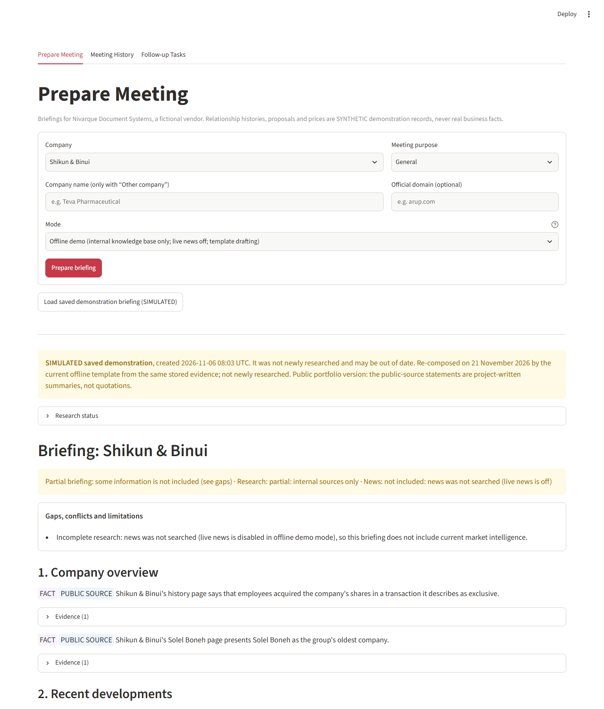
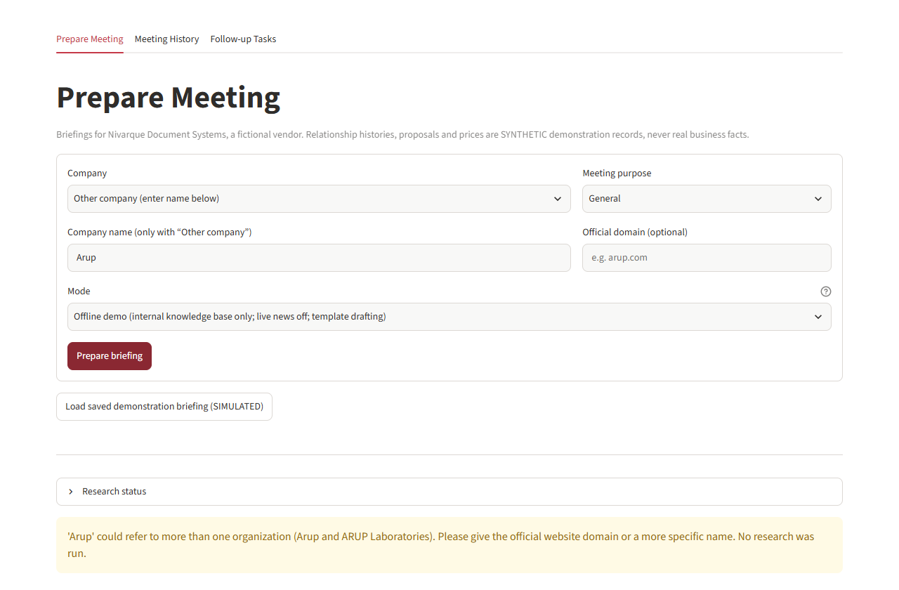
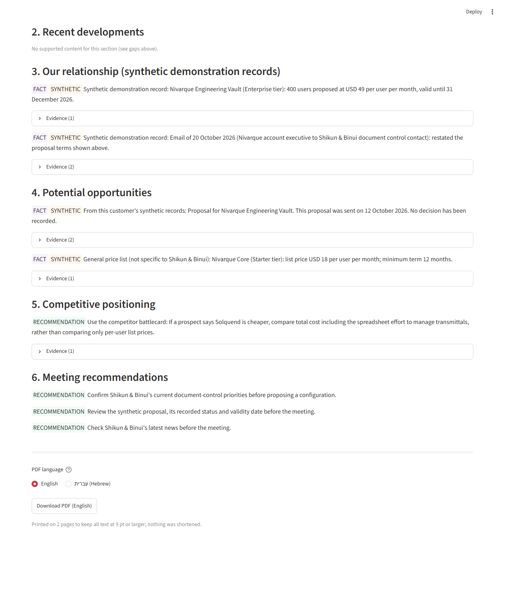
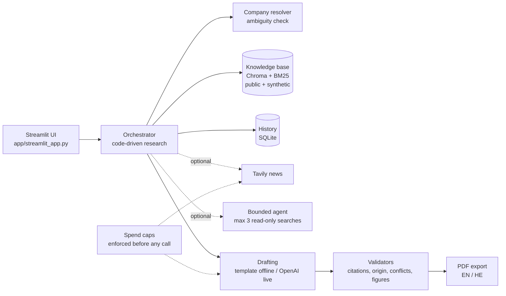

# Deal-Prep Copilot

[-2ea44f?style=for-the-badge)](http://localhost:8501)

> **About the "▶ Run App (Local)" button:** it only opens the Streamlit interface at `http://localhost:8501`, and only if the application is
> **already running on your own computer**. It does **not** start Streamlit, and it cannot launch the application on anyone else's computer.
> If nothing is running locally, your browser will show a connection error. See "Starting the app" below to start it.

A meeting-briefing assistant for a salesperson at **Nivarque Document Systems**, a **fictional** vendor of
document-management (DMS) software. Give it a company name and a meeting purpose. It researches the company in a local
knowledge base (and, optionally, in live news), drafts a short briefing in which every statement cites a source, checks
the draft in code, and exports it as an English or Hebrew PDF. It also keeps meeting history and follow-up tasks.

It is a **professional portfolio project**, not a product. It runs locally on Windows, is not deployed, and has
no user accounts. The project began as a classroom exercise and has continued as an independent portfolio project
(decision D17 in the private development log).

> **Fictional vendor, synthetic relationships, real public sources.** Nivarque Document Systems and its competitor
> Solquend Archive Systems are invented. The customer companies named in the demos are real, but **every relationship,
> proposal, price and meeting with them is synthetic**, labelled as such, and does not imply that the real company has dealt
> with Nivarque. Public facts come from real, dated, cited sources. See "Real versus synthetic information" and "No affiliation".

## At a glance

| | |
|---|---|
| **What it shows** | Retrieval-augmented drafting with enforced citations, source-origin (provenance) rules, bounded agent use, hard cost caps, bilingual PDF output, and a pre-registered, frozen evaluation reported honestly |
| **Stack** | Python 3.11, Streamlit, Chroma + BM25 hybrid search, sentence-transformers, OpenAI API, SQLite, fpdf2, pytest |
| **Size** | 34 Python modules in `src/deal_prep/` (plus `__init__.py`), 51 test modules, a 19-document knowledge base; see "Verification" for test results |
| **Try it** | Free and offline: no API key needed (template drafting). See "Installation" and "Starting the app" |
| **Example outputs** | [`portfolio/`](portfolio/README.md): four AI-drafted briefings from the final evaluation, with context |
| **Honest status** | The final evaluation did **not** meet its acceptance criteria (see below) |
| **Publication status** | Release candidate (local); MIT license for the project's own material only (see "License") |

## Status and evaluation result (read this first)

- **Offline demonstration:** works at no cost and with no API key. This is the version to run and present.
- **Live AI drafting:** works with your own OpenAI key (capped at USD 0.10 per briefing and USD 1 per day in code). Earlier
  live checks on four companies, 6 November 2026, are recorded below under "Starting the app".
- **Final frozen evaluation (20 November 2026): the frozen acceptance criteria were NOT met.**
  - Eight scenarios were planned; **four produced briefings**. The other four produced none, because the provider's
    credits were exhausted (HTTP 429 "no credits remaining").
  - **Three Critical requirements failed** among the four completed briefings.
  - Average assessed usefulness: **3.0 out of 5**. These ratings were produced by ChatGPT and adopted by the project
    owner; they are not an independent second assessment.
  - Citation audit: **34 of 34** citation-bearing items in the completed briefings were supported or appropriately
    qualified.
  - Strengths: the Anglo American negotiation briefing (AAL-B) handled commercial approvals and customer commitments well; the
    DBS product-demo briefing (DBS-B) handled contradictory vendor documentation successfully.
  - Weakness: public-company research coverage was inadequate in the two public-only briefings (AAL-A and DBS-A).
  - A defect in the evaluation runner's stopping rule let it carry on after the first credit failure (no extra spend).
  - Details, limits of the evidence and what remains unknown: [`docs/FINAL_EVALUATION_SUMMARY.md`](docs/FINAL_EVALUATION_SUMMARY.md).
- **Earlier acceptance report (9 November 2026):** 87 PASS, 2 FAIL (documented deviations FR-03 and FR-13), 3 NOT TESTED,
  at commit `c259786`. It predates the final evaluation and the PDF redesign, and it was obtained with the development repository's version,
  which quoted its sources; it was not regenerated for this public version ([`docs/ACCEPTANCE_REPORT.md`](docs/ACCEPTANCE_REPORT.md)).
- **Verification (21 November 2026, Windows 11, Python 3.11.17):**
  - Historical: the development repository's complete offline suite passed 1297 tests on 20 November 2026. That figure includes five
    test modules for the frozen evaluation and development replays, which are not part of this package, so it does not describe this version.
  - This public portfolio version's suite (1212 tests in 51 modules): **1212 passed** in one uninterrupted run (11 min 7 s), run alone,
    in a temporary copy initialized as a Git repository (one test checks that held-out files are not tracked by Git). Expected strings in
    one test module and one fixture were adapted to the project-written summaries (see "Public portfolio version").
  - Offline rehearsal (`scripts/demo_rehearsal.py`): **35 of 35** checks passed.
  - Retrieval evaluation (`scripts/kb_eval.py`) on the rewritten knowledge base: document-level Recall@5 11/11, passage-level 10/11
    (the same figures as the earlier fresh-install check).
  - The app started offline and loaded the saved SIMULATED briefing without errors (development environment, with the summaries); a start in a
    fresh virtual environment built from `requirements.txt` (`pip check` clean) was verified earlier the same day, before the summaries.
  - Running other Chroma-using processes at the same time can trigger the intermittent Chroma error (limitation 15): earlier that day a
    fresh-environment run alongside other checks gave 56 errors that passed (72/72) when the module was rerun alone. Run the suite on its own.
  - Not verified: live AI or news, other operating systems, a machine other than the development machine, a clone from a Git remote.
Known limitations: [`docs/KNOWN_LIMITATIONS.md`](docs/KNOWN_LIMITATIONS.md). Optional short interview walkthrough:
[`docs/DEMO_GUIDE.md`](docs/DEMO_GUIDE.md). Portfolio overview, example PDFs and CV text: [`portfolio/`](portfolio/README.md).

## What it does

1. Resolves the company (an ambiguous name such as "Arup" stops and asks for the official domain).
2. Searches the knowledge base (hybrid vector + keyword search) for public facts and synthetic customer records.
3. Optionally searches live news and runs a bounded AI agent (at most three read-only follow-up searches).
4. Drafts a briefing in six sections: company overview, recent developments, our relationship, potential opportunities,
   competitive positioning and meeting recommendations. Each item is tagged `FACT`, `ANALYSIS` or `RECOMMENDATION` and carries
   an origin badge: `PUBLIC SOURCE` or `SYNTHETIC`.
5. Rejects the draft in code if a citation does not exist, has the wrong origin, a conflict is undisclosed or a gap is unexplained.
6. Exports an English or Hebrew (right-to-left) PDF.
7. Stores meeting notes (draft, then approved), follow-up tasks and the briefing history in a local SQLite database.

Screenshots (offline app, synthetic demonstration data):







Example output: the saved demonstration PDFs `portfolio/pdfs/examples/saved_demo_shikun_binui_en.pdf` and `..._he.pdf`
(offline, labelled SIMULATED) and the recorded live-AI PDFs in [`portfolio/`](portfolio/README.md).

## Architecture



| Layer | Technology | Where |
|---|---|---|
| Interface | Streamlit (three pages: Prepare Meeting, Meeting History, Follow-up Tasks) | `app/streamlit_app.py` |
| Research | Chroma vector index, `all-MiniLM-L6-v2` embeddings, BM25, rule-based provenance | `src/deal_prep/` (`orchestrator.py`, `kb_index.py`, `provenance.py`) |
| AI | OpenAI models: gpt-6.1-terra drafts, gpt-6-luna reviews research gaps and runs the bounded agent | `briefing.py`, `agent.py` |
| Validation | Citation, disclosure, figure and conflict checks | `citations.py`, `disclosures.py`, `figure_verify.py`, `conflict_guard.py` |
| Output and storage | fpdf2 PDFs (about 10 pt body, never below 9 pt); SQLite history | `pdf_export.py`, `history.py` |
| Cost control | Hard caps checked before every call | `spend.py` |

Pipeline steps in detail are under "How it works" below.

## Real versus synthetic information

Every piece of information has one of two origins (spec v1.2 §6B), and the two are kept strictly apart:

| Origin (`info_origin`) | What it is | Where |
|---|---|---|
| `public_source` | Dated snapshots of real companies' public information, or live news. Each keeps its source URL, publisher, publication date (or `unknown`), retrieval date, verification level and a short summary of the source's statement (a project-written summary, not a quotation; the Wikipedia entry quotes verbatim). | `data/kb_v1/public/`, live news |
| `synthetic_record` | Invented material: the fictional vendor Nivarque, its fictional competitor **Solquend Archive Systems**, price lists, policies, and **synthetic** proposals, emails and meeting notes. Meeting records you enter in the app are synthetic too. | `data/kb_v1/synthetic/`, `runs/history.sqlite` |

- **Real or fictional** is recorded per organization in `data/kb_v1/organizations.json`.
- **Demo companies:** Shikun & Binui, Ashtrom Group and Arup are real companies. **All** sales relationships,
  proposals, prices and meetings involving them are synthetic, are labelled *"SYNTHETIC — not a real business fact"*,
  and never imply that the real company has dealt with Nivarque.
- **Final-evaluation companies:** Anglo American, DBS Group, Target Corporation and Toyota are real companies used the same
  way: their public information is real and cited, and their "history" with Nivarque (scenarios marked B) is a fictional
  record written for the test.
- **Look-alike:** ARUP Laboratories is a real, unrelated organization, used only to test name disambiguation.
- **Origin rule:** synthetic records cannot prove real-world facts, and public sources cannot prove the fictional
  vendor's prices or relationships. Code enforces this; a wrong-origin citation is rejected.
- **Frozen baseline:** the Prompt 01 corpus (`data/synthetic/dms/`) is a regression fixture and never used in briefings.
- **Classroom material:** `classroom/` (NexaStream) is local-only, gitignored and never indexed.

## No affiliation

This project has no affiliation with, and is not endorsed by, Shikun & Binui, Ashtrom Group, Arup, ARUP Laboratories,
Skanska, Anglo American, DBS Group, Target Corporation, Toyota or any other real organization named in it, and none of
them has reviewed it. Their names are used only to identify them as the subjects of cited public information. They may be
trademarks of their owners. Nivarque Document Systems and Solquend Archive Systems are fictional, and any resemblance to a
real company is unintended.

## Third-party content

- **Public-source summaries** (`data/kb_v1/public/NVQ-PUB-001` to `007`): in this public portfolio version the statements of the
  organizations' own websites and of Arup's 2024 financial statements are **independently written summaries of publicly stated
  facts**, not quotations. Each file names its source URL, publisher, publication date (or `unknown`) and retrieval date (spec v1.2
  §6B). The publishers keep their rights in their pages. Details and the terms found for each source: `THIRD_PARTY_NOTICES.md`.
- **Evaluation sources:** the final evaluation used copies of public documents (annual reports, filings, web pages) from the
  publishers' own sites. They are **not included** in this repository. Only the evaluation's own documents are published
  (`docs/evaluation_evidence/`). The development archive that holds them is private.
- **Wikipedia:** the five short quotations in `NVQ-PUB-008` come from the English Wikipedia article "ARUP Laboratories"
  (https://en.wikipedia.org/wiki/ARUP_Laboratories, revision of 19 October 2026) and are kept verbatim, marked as quotations. Wikipedia
  text is available under CC BY-SA 4.0 (https://creativecommons.org/licenses/by-sa/4.0/); the article's authors are listed in its page
  history. That file keeps its CC BY-SA license.
- **Live news** (live mode only): excerpts and links from news search results are kept only in local, gitignored run
  records and briefings. None is committed.
- **Not included:** the embedding model (downloaded from Hugging Face under its own license), the Arial font (read from
  the local Windows installation) and the Python packages in `requirements.txt` (each under its own license).
- **License:** MIT, see `LICENSE`. It covers only the project's own material: the application code, the tests, the scripts, the documentation and the
  synthetic corpus. It does **not** cover third-party content or components, which keep their own terms and attribution: the facts about real
  companies and their names and trademarks, the CC BY-SA 4.0 Wikipedia quotations in `NVQ-PUB-008`, and the model, packages and fonts that are
  installed separately. See `THIRD_PARTY_NOTICES.md`.

## Public portfolio version

This repository is a cleaned public version of a private development repository. What differs, so that nothing is attributed to the wrong
version:

- **Public-source text.** The statements of company websites are project-written summaries (see "Third-party content"); the development
  repository stored short verbatim quotations. Facts, years and figures are unchanged. A passage that would be shown in quotation marks as
  though the source said it is prefixed "Summary:".
- **Saved demonstration and PDFs.** `data/demo/saved_briefing_shikun_binui.json` and `portfolio/pdfs/examples/` were rebuilt on 21 November
  2026 from the same stored evidence with the summaries (still SIMULATED, not newly researched). The three screenshots were retaken or
  rechecked against it.
- **Tests.** Expected strings in `tests/test_disclosures.py` and one fixture in `tests/test_provenance.py` were adapted to the summaries;
  the conflict logic they test is unchanged. Five test modules for the frozen evaluation and development replays are not included, and an
  unused 959 KB replay fixture of real-company evaluation text was removed. `scripts/demo_rehearsal.py` expects the current two-page PDF.
  These adaptations belong to this version only; they are **not** part of the frozen evaluation or of the development benchmark results.
- **Historical results are unchanged and describe the earlier version.** The 9 November 2026 acceptance report (87 PASS, 2 FAIL, 3 NOT
  TESTED) and the final frozen evaluation (20 November 2026; did **not** meet its acceptance criteria) were produced with the
  development repository. They were not rerun for this version.

## Requirements

| Item | Version or note |
|---|---|
| OS | Windows 10/11 (verified on Windows 11). The Hebrew PDF uses Arial from `C:\Windows\Fonts` by default. |
| Conda | Miniconda or Anaconda (verified with conda 26.5.3) |
| Python | 3.11 in a Conda environment. Verified with 3.11.17 (`deal_prep_env`) and 3.11.18 (fresh install, 8 November 2026). `python=3.11` installs the newest 3.11 release. |
| Packages | Pinned in `requirements.txt` (chromadb 1.1.1, sentence-transformers 3.3.1, torch 2.14.1, streamlit 1.67.0, fpdf2 2.9.0, uharfbuzz 0.57.0, openai 3.42.1, …). Only direct dependencies are pinned; the others resolve to the newest compatible versions at install time. |
| Download and disk | About 0.5 GB to download (Python packages about 350 MB, embedding model about 87 MB, conda packages about 36 MB) and about 1.8 GB of disk for the environment. Measured on Windows 11, 8 November 2026. |
| Embedding model | `sentence-transformers/all-MiniLM-L6-v2`, about 90 MB, in the local Hugging Face cache |
| API keys | **Not needed** for the offline demo. Optional: OpenAI (live drafting) and Tavily (live news). |

## Installation

Clone the repository and open a Conda prompt in its folder (`git clone <repository URL>`, then
`cd Deal-Prep-Copilot`). Then create the environment and install the packages. The package install took about
7 minutes in the fresh-install check; this depends on the connection.

```
conda create -n deal_prep_env python=3.11
conda activate deal_prep_env
python -m pip install -r requirements.txt
python -m pip check
```

Download the embedding model **once** (free, needs internet, about 87 MB). Everything afterwards runs offline:

```
python -c "from sentence_transformers import SentenceTransformer; SentenceTransformer('sentence-transformers/all-MiniLM-L6-v2')"
```

Verify the installation offline (in PowerShell, set the variables with `$env:NAME = "value"` instead):

```
set HF_HUB_OFFLINE=1
set TRANSFORMERS_OFFLINE=1
set ANONYMIZED_TELEMETRY=False
set DEAL_PREP_NO_DOTENV=1
python -m pytest -q                       # 1297 passed on 20 November 2026; see "Verification" for the 21 November rerun
python scripts/demo_rehearsal.py          # expected: all rehearsal checks pass
```

**Fresh-install check (8 November 2026, commit `e3c0ba2`, before later tests were added):** a new clone and a
new Conda environment with empty package and model caches gave 427 tests passed, rehearsal 29/29, Recall@5 11/11 documents and 10/11 passages, and an offline app start.
This was run on the development machine only; see `eval/manual_checks_v1.json` (MC-05) for its limitations. A fresh
install has not been repeated since.

## Data

- **Knowledge base:** the curated corpus (`data/kb_v1/`, 19 documents in five formats) is committed. Nothing needs to
  be generated.
- **Index:** the local Chroma index (`chroma_db/`, collection `dms_kb_v1`) is built automatically on the first
  briefing, or with `python scripts/kb_eval.py`. If the index is found incomplete, it is rebuilt before research and
  the briefing says so.
- **Regenerating the synthetic DOCX/XLSX/PDF files** (`python scripts/generate_kb_corpus.py`) is optional. It produces
  identical content; the DOCX and XLSX files differ only in archive timestamps. Undo with
  `git checkout -- data/kb_v1/synthetic`.
- **Saved demonstration:** `data/demo/saved_briefing_shikun_binui.json`, labelled SIMULATED, with its original date.
  Recreate it with `python scripts/make_saved_demo.py` (offline).
- **History:** meeting records, tasks and saved briefing snapshots live in `runs/history.sqlite` (created on first use,
  gitignored). Approved meetings are also indexed in the Chroma collection `dms_history_v1`.

## Starting the app

```
conda activate deal_prep_env
set HF_HUB_OFFLINE=1
set TRANSFORMERS_OFFLINE=1
set ANONYMIZED_TELEMETRY=False
streamlit run app/streamlit_app.py --server.address 127.0.0.1 --server.port 8501
```

In PowerShell:

```
conda activate deal_prep_env
$env:HF_HUB_OFFLINE = "1"
$env:TRANSFORMERS_OFFLINE = "1"
$env:ANONYMIZED_TELEMETRY = "False"
streamlit run app/streamlit_app.py --server.address 127.0.0.1 --server.port 8501
```

Open http://127.0.0.1:8501. The app has three pages: **Prepare Meeting**, **Meeting History** and
**Follow-up Tasks**. They share the selected company.

| Mode | Shown when | What it does | Cost |
|---|---|---|---|
| Offline demo | always | Local knowledge base only; news off; briefing assembled by a template (**no AI**) | none |
| Live AI drafting | `OPENAI_API_KEY` is set | Drafting by gpt-6.1-terra, research gaps reviewed by gpt-6-luna; news off | max $0.10 per briefing, $1 per day |
| Live AI + live news | both keys are set | As above, plus Tavily news (48 hours, then 30 days) | plus max 5 Tavily credits per briefing, 50 per day |

Offline mode shows the interface, the labelling and the checks. It does **not** show AI quality, because the offline
briefing is a template. AI output can be seen in the recorded PDFs in [`portfolio/`](portfolio/README.md).

- Each request runs **once**. Reruns, language switches and downloads reuse the saved result, so they never spend again.
- Spending and credit caps are enforced in code before any call. Daily totals are kept in
  `runs/openai_spend_ledger.json` and `runs/tavily_credit_ledger.json`.
- **Verified live** on 6 November 2026 for four real companies: Arup, Shikun & Binui, Ashtrom Group and Skanska
  (outside the registry). **Measured** per briefing (each figure is one recorded run, not an average):

  | Company | Mode | Time | OpenAI | Tavily credits |
  |---|---|---|---|---|
  | Arup | live AI, news off | 25.9 s | $0.010811 | 0 |
  | Arup | live AI + news | 22.1 s | $0.010104 | 1 |
  | Shikun & Binui | live AI + news | 32.7 s | $0.013035 | 1 |
  | Ashtrom Group | live AI + news | 17.6 s | $0.007383 | 1 |
  | Skanska | live AI + news | 26.8 s | $0.008856 | 3 |

  Measured range: **17.6–32.7 seconds** per briefing. **Estimate** for a new live briefing, based on these runs and
  not guaranteed: about $0.007–0.013 and 1–3 Tavily credits. The caps above are the only hard limits.
- The four completed final-evaluation briefings (20 November 2026, news fixtures empty) cost USD 0.0134, 0.0201, 0.0098 and
  0.0173 (total USD 0.0606).
- **Not yet verified live:** AI drafting with approved meeting history in the application's own interface (FR-14), the
  prompt-injection test against the real model (AT-11, AC-31) and the measured fixed-workflow versus agent comparison
  (AT-16). See `docs/KNOWN_LIMITATIONS.md`. The provider account's credits were exhausted on 20 November 2026, so a live run needs a topped-up account.

## Configuration

API keys go in `.env` (copy `.env.example`; `.env` is gitignored and never committed). The app reads `.env` at runtime
and never displays or logs the keys. The other variables are read from the **process environment** only (set them in
the shell; they are not read from `.env`).

| Variable | Default | Purpose |
|---|---|---|
| `OPENAI_API_KEY` | unset | Enables live AI drafting (in `.env`) |
| `TAVILY_API_KEY` | unset | Enables live news, together with the OpenAI key (in `.env`) |
| `HF_HUB_OFFLINE`, `TRANSFORMERS_OFFLINE` | unset | Set to `1` so the embedding model is never downloaded at runtime |
| `ANONYMIZED_TELEMETRY` | unset | Set to `False` to keep Chroma telemetry off (the code also disables it) |
| `CHROMA_DIR` | `chroma_db` | Index folder, relative to the project root |
| `EMBEDDING_MODEL` | `sentence-transformers/all-MiniLM-L6-v2` | Embedding model name (must be cached) |
| `DEAL_PREP_HISTORY_DB` | `runs/history.sqlite` | History database path |
| `DEAL_PREP_APP_CHROMA_DIR` | unset | Index folder for the app only (used by tests) |
| `DEAL_PREP_FONT_DIR` | `C:/Windows/Fonts` | Folder with `arial.ttf`, `arialbd.ttf`, `ariali.ttf` for the Hebrew PDF |
| `DEAL_PREP_NO_DOTENV` | unset | Set to `1` to never read `.env` (the test suite sets it) |

## Network requirements

| Activity | Network |
|---|---|
| Installing packages; first download of the embedding model | Internet (PyPI, Hugging Face), once |
| Offline demo, tests, evaluation, rehearsal, PDF export, history | **None** (verified with outbound connections blocked) |
| Live AI drafting | api.openai.com (paid, capped) |
| Live news | api.tavily.com (credits, capped) |

## Commands

```
python -m pytest -q                       # full test suite (offline)
python scripts/acceptance_report.py       # runs everything offline; rewrites docs/ACCEPTANCE_REPORT.md
python scripts/demo_rehearsal.py          # offline rehearsal of all demo scenarios, with label checks
python scripts/kb_eval.py                 # builds dms_kb_v1 and runs eval/cases_v1.json (Recall@5)
python scripts/generate_kb_corpus.py      # regenerates the synthetic DOCX/XLSX/PDF files (optional)
python scripts/make_saved_demo.py         # recreates the SIMULATED saved demonstration (offline)
python scripts/retrieval_check.py         # Prompt 01 frozen baseline check
python scripts/live_news_check.py         # PAID: one live Tavily search. Run only with owner authorization.
python scripts/live_briefing_check.py     # PAID: one live briefing. Run only with owner authorization.
```

Results are saved to `runs/` (gitignored). The scripts that ran the final evaluation (`fresh_evaluation_run.py`, its freeze
verifier) and the earlier real-company evaluations are not part of this package, because they need the excluded source
materials; they remain in the private development archive.

## Troubleshooting

| Symptom | Cause and fix |
|---|---|
| Error that the embedding model is not cached | Download it once (see Installation). Runtime code never downloads it. |
| Only "Offline demo" in the Mode list | No API keys were found in `.env`. This is expected for the offline demo. |
| "The Hebrew PDF needs a Unicode font…" | Set `DEAL_PREP_FONT_DIR` to a folder with `arial.ttf`, `arialbd.ttf` and `ariali.ttf`. |
| "The local knowledge-base index was incomplete … and was rebuilt" | Informational. The index was repaired before research. |
| "NVQ-… could not be read" while building the index | That corpus file is damaged. Restore it with `git checkout -- data/kb_v1`. |
| Chroma error "Error creating hnsw segment reader: Nothing found on disk" | Seen intermittently in testing, cause unconfirmed. Retry. If it persists, stop the app, delete `chroma_db/`, start again, and run the history reconcile below. |
| Approved meetings missing from new briefings after deleting `chroma_db/` | Rebuild the history index: `python -c "from deal_prep.app_service import BriefingService; print(BriefingService().reconcile_history())"` (run from `src/`, or with `PYTHONPATH=src`). |
| "Xet Storage is enabled … hf_xet" message during the model download | Informational. The model downloads over normal HTTP. |
| "Port already in use" | Start with another `--server.port`. |
| Cannot delete `chroma_db/` | Stop the app first; Chroma keeps its files open while running. |
| `git status` shows the synthetic DOCX/XLSX files as modified | They were regenerated; only archive timestamps changed. `git checkout -- data/kb_v1/synthetic`. |
| Live mode: "The language model could not be reached" | The key is missing or invalid, or the provider account has no credits (HTTP 429). Offline mode still works. |

## How it works

1. **Validate and index.** `provenance.py` checks every document against the registry and the §6B rules; any invalid
   document blocks the build. `kb_extract.py` reads all five formats (one passage per table row, with location).
   `kb_index.py` writes the Chroma collection `dms_kb_v1`; provenance labels are metadata, never embedded.
2. **Research (code, not AI).** `orchestrator.py` resolves the company (ambiguous names stop and ask), runs the
   mandatory internal searches (hybrid vector + BM25), adds approved meeting history, and runs the news search
   (48 hours, then 30 days).
3. **Agent (optional, bounded).** `agent.py` may make at most three read-only follow-up searches.
4. **Draft and check.** `briefing.py` asks for one structured draft; `citations.py` and `disclosures.py` reject
   invented citations, wrong-origin claims, undisclosed conflicts and unexplained gaps (one retry, then a clear error).
5. **Output.** `pdf_export.py` renders an English or Hebrew (right-to-left) PDF (about 10 pt body text, natural pagination, never below 9 pt) with origin badges and sources.
6. **History.** `history.py` (SQLite, the source of truth) stores companies, dated snapshots, meetings
   (DRAFT → APPROVED) and tasks, with idempotent writes. `history_index.py` indexes approved meetings only.

## Evaluation materials

| Where | What |
|---|---|
| `docs/FINAL_EVALUATION_SUMMARY.md` | Result and limits of the final frozen evaluation |
| `docs/evaluation_evidence/` | Unmodified copies of the freeze manifest, freeze report, run authorization and the 43-requirement summary |
| `eval/benchmark_v1/` | Fictional-company benchmark used in development, with its results notes |
| `docs/ACCEPTANCE_REPORT.md` | Earlier (9 November 2026) acceptance report |

**References to files not included.** Some historical documents and code comments cite files from the private development archive
(for example `eval/fresh_evaluation/`, `eval/real_companies_v2/`, `docs/reports/`, `docs/DECISIONS_LOG.md`). Those files are not
in this package: they include copies of third-party documents that have not been cleared for redistribution. The frozen
evaluation's SHA-256 verification can only be run in the archive.

## Layout

```
app/streamlit_app.py  user interface (three pages)
src/deal_prep/        application code (see "How it works"); Prompt 01 modules are frozen
data/kb_v1/           knowledge base: organizations.json, manifest.json, public/, synthetic/
data/demo/            saved SIMULATED demonstration briefing
data/synthetic/dms/   frozen Prompt 01 corpus
eval/                 retrieval ground truth, acceptance cases, manual checks, fictional-company benchmark
scripts/              evaluation, acceptance, rehearsal, corpus and live-check scripts
tests/                pytest suite
docs/                 specification, acceptance report, interview walkthrough (`DEMO_GUIDE.md`), limitations, final evaluation summary, evaluation evidence copies
portfolio/            recruiter overview, CV/LinkedIn text and copies of the four recorded final-evaluation PDFs
```

Specification: `docs/DEAL_PREP_COPILOT_SPEC_v1_2.md`.
